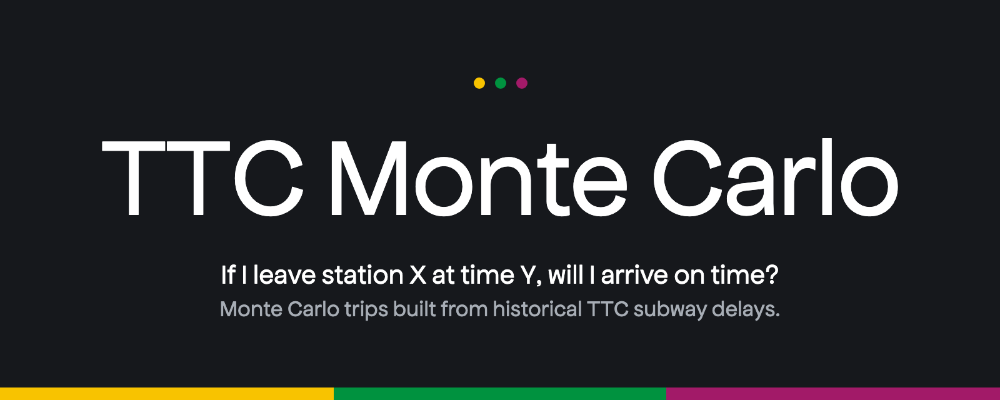
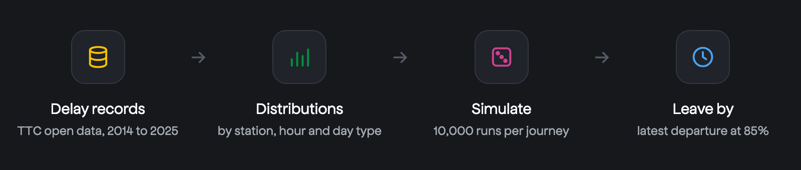

<p align="center">
  
</p>

<p align="center">
  
</p>

**[Open the live site](https://ttcmontecarlo.vercel.app)**

Pick a start station, an end station and a departure time. The simulator gives the probability that you arrive on time, from 171,973 historical delay records (2014 to 2025) on the Toronto Open Data portal. It is a Monte Carlo simulation of the Toronto Transit Commission subway network.

Answers one question: **if I leave station X at time Y, what is the probability I arrive at station Z on time?**

---

## How it works

The simulator builds empirical delay distributions from 171,973 historical delay records (2014–2025) sourced from the Toronto Open Data portal. For each (station, hour, weekday/weekend) combination it estimates:

- **P(delay occurs)** - incident rate relative to total trains through that station
- **Delay magnitude distribution** - empirical sample of recorded delay minutes

On each simulated journey it walks the route segment by segment, sampling a random delay at each station from the historical distribution for that departure context. After 10,000 runs it returns the full travel time distribution and key percentiles.

The **leave-by solver** runs this simulation for every departure hour and finds the latest one satisfying a required confidence level (default 85%). It also adjusts for current weather conditions using a risk multiplier derived from historical delays under similar weather.

---

## Stack

| Layer | Technology |
|---|---|
| Data source | Toronto Open Data CKAN API, Open-Meteo API |
| ETL | Python, pandas, openpyxl |
| Storage | Apache Parquet |
| Simulation | NumPy (vectorized Monte Carlo) |
| Backend API | FastAPI, uvicorn |
| Frontend | Next.js 16 (App Router), vanilla CSS |

---

## Running locally

```bash
# 1. Install dependencies
pip install -r requirements.txt

# 2. Fetch data (one-time)
python -m src.etl.fetch_delays
python -m src.etl.fetch_weather
python -m src.etl.clean_delays

# 3. Start backend
uvicorn api.main:app --port 8000

# 4. Start frontend
cd frontend && npm install && npm run dev
```

Open `http://localhost:3000`.

---

## Data

Raw delay data: [Toronto Open Data - TTC Subway Delay Data](https://open.toronto.ca/dataset/ttc-subway-delay-data/)

Weather data: [Open-Meteo Historical Weather API](https://open-meteo.com/)
